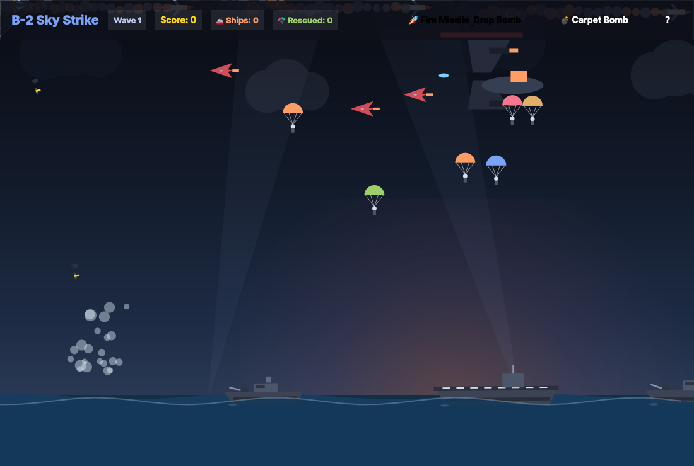

# Sky Strike

B-2 Spirit stealth bomber air and naval combat game for Omarchy, designed for effortless mouse control and explosive arcade action.



## Features

- **B-2 Spirit Stealth Bomber**: Fly the iconic flying-wing stealth bomber with sawtooth trailing edge, flush cockpit windows, and internal bomb bay doors.
- **Big Cruise Missiles & Dramatic Impact**: Launch heavy cruise missiles with roaring afterburner plumes, supersonic shockwave rings, multi-stage fireballs, dark smoke clouds, and screen shake.
- **Bombing Runs on Planes & Warships**: Drop gravity bombs and carpet-bomb salvos from the B-2 Spirit's bomb bay onto lower enemy fighter planes and enemy warships steaming below.
- **Wartime Seascape**: Dynamic rolling ocean swells, whitecap waves, searchlight beams, water splash geysers, and enemy destroyers, cruisers, and aircraft carriers that catch fire and sink when bombed.
- **Giant Mothership & Paratroopers**: Enemy mothership launches small fighter jets while paratroopers parachute down for mid-air rescue.

## Keyboard and Mouse Controls

| Input | Action |
| --- | --- |
| **Mouse Move** | Fly the B-2 Spirit stealth bomber across the sky |
| **Mouse Left Click** / **Space** | Fire heavy cruise missile forward + drop gravity bomb downward |
| **Mouse Right Click** / **B** | Unleash a 4-bomb carpet bombing salvo |
| **P** | Pause / Resume |
| **?** | Toggle help and shortcuts overlay |
| **Q** | Quit |

## Command-Line Usage

```sh
# Open the game window
skystrike open

# Check high score and game statistics in JSON
skystrike status --json

# Install agent skill
skystrike skill install
```

## Building and Testing

```sh
bin/build    # Compiles with qmake6 and make
bin/test     # Runs offscreen Qt tests
bin/install  # Installs desktop launcher entry and binary
```
